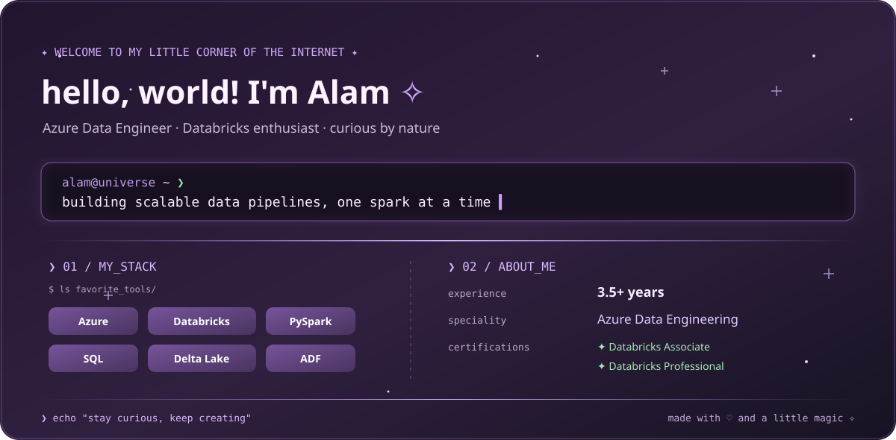

### ✧ apparently my life is all about ✧

**Data Engineer | Azure | Databricks | PySpark**

*Building things, solving problems, and finding magic in data.*

---

  

### Me..?

Heyy viewer! I'm a Data Engineer with **3.5+ years of experience** building scalable data engineering solutions on Azure.
I enjoy transforming complex data into meaningful insights, designing efficient pipelines, and exploring better ways to work with big data.

- ☁️ Working with Azure and Databricks
- ⚡ Building scalable ETL/ELT pipelines
- 🪄 Exploring Spark optimization and lakehouse architecture
- 🌱 Always learning something new

### 🛠️ things I build with

*Every project starts with a little curiosity.*

### read this...

  
pssst... there's a little something for you ♡

 
If you've made it this far, here's a little reminder: 
**You don't have to have everything figured out.**  
Keep learning, keep creating, keep being curious. 
And never stop finding magic in the little things. ✨ 
Here's a tiny cookie for your journey 🍪

---

### ✨ a little magic, a little code, and a lot of curiosity.

*thanks for visiting my side of Github* ♡

  

